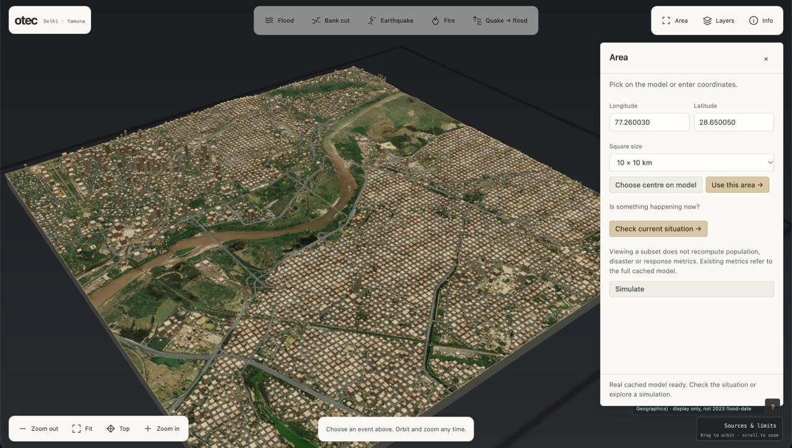
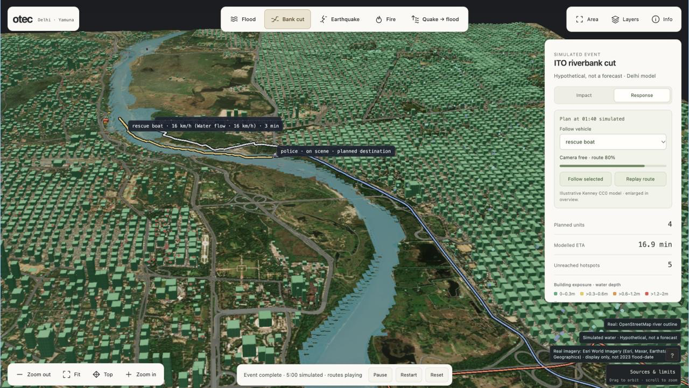
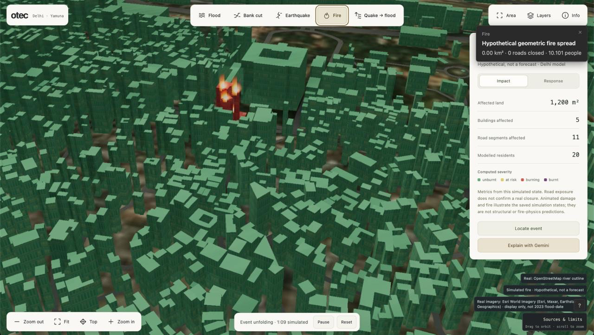
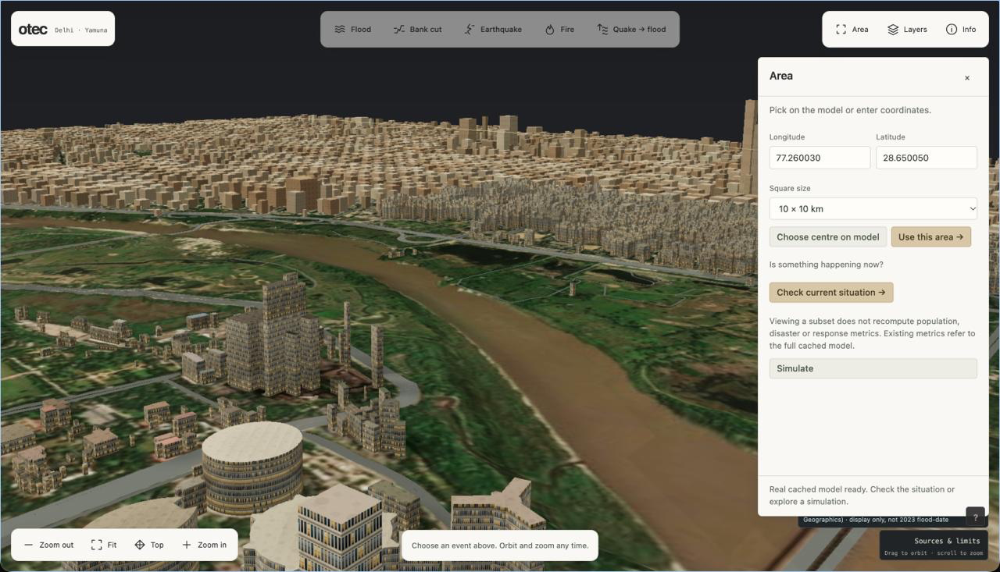

# Otec

### From drone data to disaster decisions

Otec is a prototype disaster response workspace built by **Team Mellanic**. It brings a navigable 3D model of Delhi's Yamuna corridor together with hypothetical disaster simulations, impact estimates and modelled response routes. The goal is to give responders a shared picture for human-reviewed decisions.



The project has two demonstrated components: the Delhi response workspace and a separate drone reconstruction proof using imagery from Ohio. **Direct import of reconstructed drone geometry into the response workspace is a next step**, not a completed integration.

## Explore the workspace

| | |
|---|---|
|  |  |
| Modelled response routes and vehicle playback | Illustrative fire spread and impact estimates |



Screenshots show example states of the prototype. Imagery is display-only and availability depends on the configured source; it is not evidence of conditions during the 2023 flood.

- **Explore the city:** navigate terrain, buildings, roads, the river and mapped facilities; choose an area and adjust the view.
- **Replay hypothetical events:** explore flood, riverbank cut, earthquake, fire and earthquake-to-flood scenarios on a shared timeline.
- **Inspect impact:** view computed exposure for land, buildings, roads and estimated residents as an event unfolds.
- **Review a response:** inspect modelled routes, vehicle playback, hotspots and estimated arrival times. Facilities come from OpenStreetMap; vehicle availability and dispatch are assumptions.
- **Request an explanation:** an optional Gemini briefing can explain the selected frame using its computed evidence. An operator remains responsible for decisions.

## What the prototype does and does not claim

**All five event modules are hypothetical, not forecasts or verified disaster impacts.** Fire and earthquake effects are illustrative models; simulated flood water is not an observed flood map. Road closures, vehicle movements, ETAs and resource availability are modelled, and no real-world dispatch takes place. WorldPop estimates residents, not live occupancy or casualties. A mapped school is a potential relief site, not a confirmed shelter.

The July 2023 Yamuna flood replay and satellite scoring are separate from these scenarios. They require real Sentinel-1 masks and a calibrated elevation datum; missing inputs remain unavailable rather than being replaced with fabricated data. See [the product contract](docs/part-d.md) for model assumptions and limitations.

## Drone reconstruction proof

The reconstruction pipeline processes original [OpenDroneMap Aukerman](https://github.com/OpenDroneMap/odm_data_aukerman) drone photographs with COLMAP and OpenMVS, aligns the result using GPS, and compares its surface with independent USGS LiDAR. The imagery is from Ohio, not Delhi.

In the run presented in the project slides, all 77 cameras registered. The held-out surface comparison reported **1.06 m NMAD** and **5.29 m RMSE**. The images date from 2016 and the LiDAR project from 2019–2020, so changes on the ground contribute to differences. Registration is weakly constrained, some diagnostics remain unavailable, and building-height accuracy is not established. See the [drone proof guide](scripts/drone_proof.md) for the method and limitations.

## Getting started

The demo is designed for macOS on Apple Silicon and does not require CUDA. Install Python 3.11, [uv](https://docs.astral.sh/uv/getting-started/installation/), Node.js 22.12 or later, and npm. Initial dependency and data downloads require internet.

```sh
make setup
make run
```

Open [http://127.0.0.1:5173](http://127.0.0.1:5173). `make run` builds the viewer and serves it with the API in one foreground process; press Ctrl-C to stop it. It uses available local data and cached runs and does not start background downloads or simulations. Raw inputs, large derived files and run outputs are not all committed, so a fresh checkout may need data preparation before the full workspace and event playback are available.

To prepare the Delhi data and start the duplicate-protected event precompute:

```sh
make data grid context buildings export
make product
```

These steps download and process large public datasets and can take substantial time. Check `logs/STATUS.md` and `logs/product_precompute.log` before starting another worker. For development, `make serve` starts the API and `make web` starts Vite in a second terminal. `make check` runs the project checks; `make build` builds the viewer.

## Data and methods

| Input | Use |
|---|---|
| [FABDEM V1-2](https://doi.org/10.5523/bris.s5hqmjcdj8yo2ibzi9b4ew3sn) | Terrain elevation, resampled to the analysis grid. The underlying source detail is coarser than the grid and is not a local survey. |
| [OpenStreetMap](https://www.openstreetmap.org/copyright) | River outlines, roads, embankments, buildings, green areas and response facilities. Coverage and attributes can be incomplete. |
| [Google Open Buildings](https://sites.research.google/gr/open-buildings/) and [Open Buildings Temporal](https://developers.google.com/earth-engine/datasets/catalog/GOOGLE_Research_open-buildings-temporal_v1) | Additional building footprints and estimated heights, combined with OSM where available. |
| [WorldPop](https://www.worldpop.org/) | Estimated resident population where the raster is available and aligned. |
| Sentinel-1 | Real flood observations for the separate historical validation workflow, only when the required masks are available. |
| [OpenDroneMap Aukerman](https://github.com/OpenDroneMap/odm_data_aukerman) and [USGS LiDAR](https://registry.opendata.aws/usgs-lidar/) | Original images and independent reference data for the separate Ohio drone proof. |

Source dates, processing details and attribution are recorded in the derived provenance files. FABDEM is licensed [CC BY-NC-SA 4.0](https://creativecommons.org/licenses/by-nc-sa/4.0/) and carries inherited Copernicus attribution. OSM data is available under the ODbL.

The analysis grid covers the Delhi–Yamuna area in UTM zone 43N. Flood experiments use a deterministic local-inertial approximation on the grid; response paths use a directed OSM road graph. Results depend on the quality and date of their inputs and on explicitly modelled assumptions. The [product contract](docs/part-d.md) and [verification report](docs/diorama-check.md) give further detail.

## Project structure

```text
sim/            Python data processing, simulations and FastAPI
web/            Vite, TypeScript and Three.js viewer
scripts/        Data acquisition, reconstruction and recording tools
data/raw/       Downloaded inputs (not committed)
data/derived/   Processed grids, context and provenance
runs/           Computed scenarios and metrics (not committed)
recordings/     Captured video and images (not committed)
docs/           Product, integration and verification notes
```

The stack includes Python, NumPy, SciPy, Rasterio, GeoPandas, FastAPI, Vite, TypeScript and Three.js. See [Gemini integration](docs/gemini.md) for the optional briefing service and [the drone proof guide](scripts/drone_proof.md) for reconstruction tools and commands.
